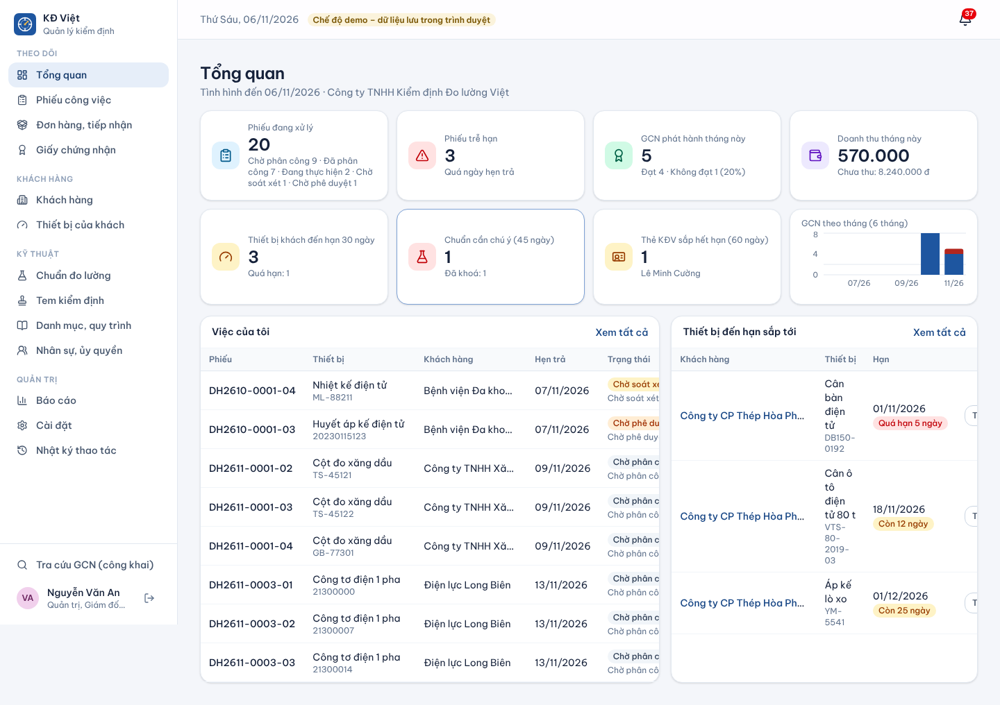
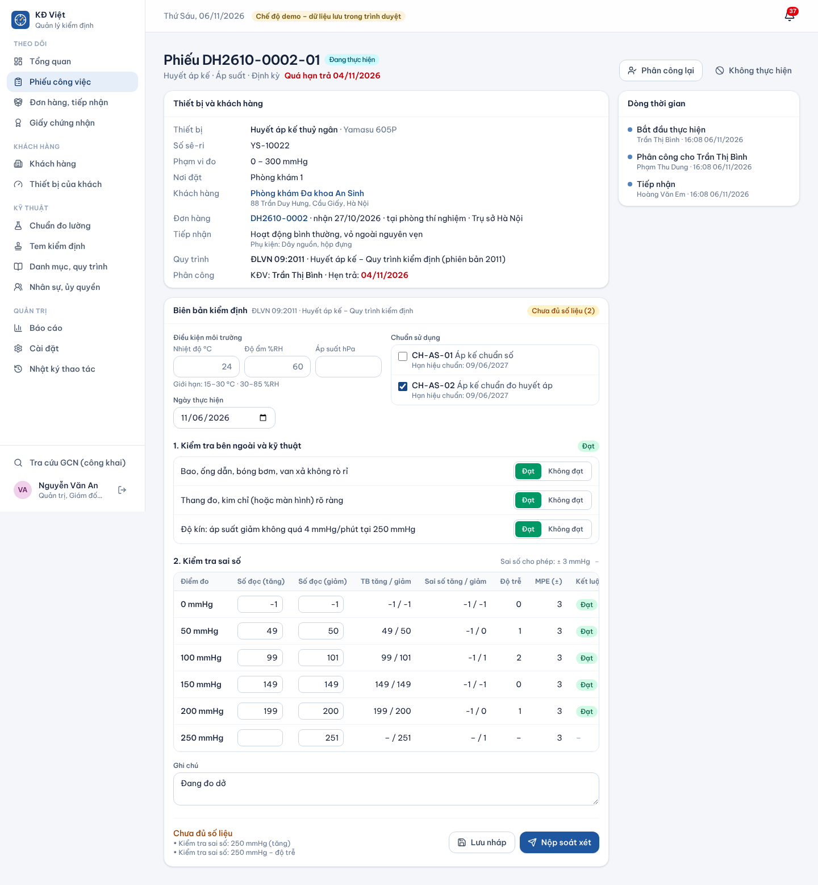
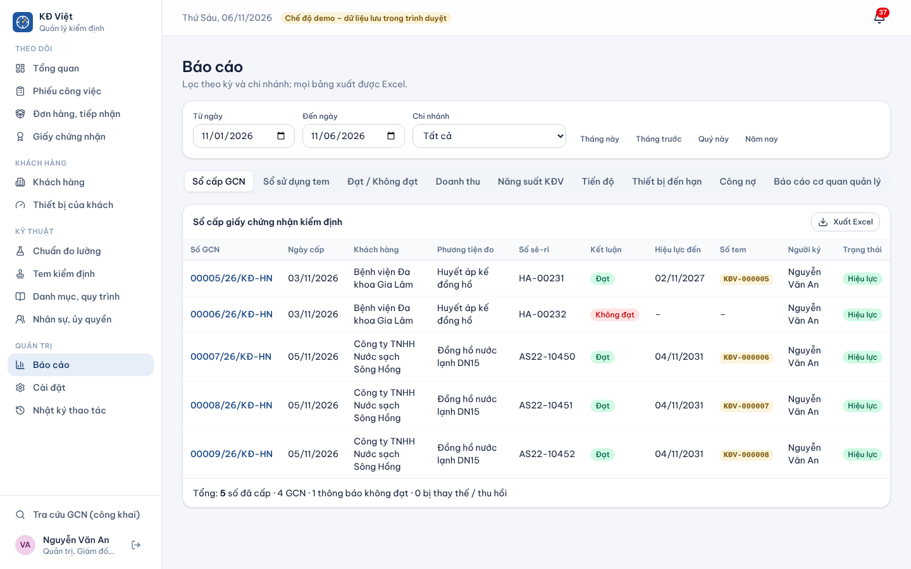
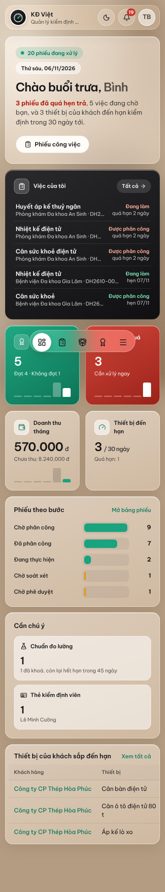

# ManagerCAL – Quản lý công ty kiểm định phương tiện đo

Phần mềm chạy toàn bộ công ty kiểm định phương tiện đo (đo lường pháp định): từ tiếp nhận thiết bị của khách, phân công kiểm định viên, nhập biên bản số liệu, soát xét, ký duyệt, phát hành giấy chứng nhận kiểm định và cấp tem, tới nhắc khách khi thiết bị đến hạn.

Kế hoạch tổng thể: [docs/KE_HOACH.md](docs/KE_HOACH.md). Phong cách giao diện: [DESIGN.md](DESIGN.md). Triển khai máy chủ: [docs/TRIEN_KHAI.md](docs/TRIEN_KHAI.md).

| Tổng quan | Biên bản kiểm định |
|---|---|
|  |  |
| **Báo cáo** | **Điện thoại (kiểm định viên)** |
|  |  |

Giấy chứng nhận in ra (A4, có mã QR tra cứu): [docs/screenshots/gcn-mau.pdf](docs/screenshots/gcn-mau.pdf).

## Chạy thử ngay

```bash
npm install
npm run dev        # mở http://localhost:5173
```

`npm run dev` chạy **chế độ demo**: không cần máy chủ, dữ liệu mẫu của một công ty hư cấu nằm trong trình duyệt. Chọn một người ở màn hình đăng nhập để vào với vai trò của người đó.

**Dùng thật (nhiều người, dữ liệu chung):** đưa lên Cloudflare – một Worker phục vụ giao diện + API, dữ liệu trong **Cloudflare D1**, đăng nhập email/mật khẩu, quy tắc nghiệp vụ kiểm tra trên máy chủ. Xem [docs/TRIEN_KHAI.md](docs/TRIEN_KHAI.md). Chạy thử bản máy chủ tại máy: `npm run dev:cf`.

App tự nhận biết: có API ở `/api` → chế độ máy chủ; không có (chạy dev, hosting tĩnh) → chế độ demo.

## Luồng nghiệp vụ

```
Tiếp nhận đơn (khách, thiết bị, giá)  →  mỗi thiết bị = 1 phiếu công việc
  → Phân công KĐV (phải có ủy quyền lĩnh vực)  →  Biên bản số liệu (phần mềm tính sai số, kết luận)
  → Nộp soát xét (chặn nếu thiếu số liệu, chuẩn quá hạn, môi trường ngoài giới hạn)
  → Soát xét (người khác KĐV)  →  Ký, phát hành GCN hoặc Thông báo không đạt, cấp tem
  → Trả thiết bị  →  Thu tiền  →  Nhắc khách khi sắp đến hạn
```

## Quy tắc chặn cứng (lớp nghiệp vụ, có kiểm thử)

1. Không chọn được chuẩn quá hạn hiệu chuẩn, hỏng, sai lĩnh vực. Chuẩn quá hạn tự khoá mỗi ngày.
2. Người thực hiện phải có ủy quyền còn hiệu lực; người soát xét khác người thực hiện; người ký có ủy quyền ký lĩnh vực đó.
3. Không phát hành khi biên bản thiếu số liệu, môi trường ngoài giới hạn, hoặc kết quả tính lại khác bản đã lưu.
4. Số GCN cấp liên tục, không trùng; GCN đã phát hành không sửa được, chỉ **thay thế** (số mới, ghi rõ thay cho số cũ) hoặc **thu hồi** (có lý do).
5. Tem chỉ cấp khi đạt; mỗi số tem dùng một lần.
6. Mọi thay đổi ghi nhật ký (ai, lúc nào, trước, sau).

## Cấu trúc mã

```
src/lib/types.ts        kiểu dữ liệu nghiệp vụ (= lược đồ SQL)
src/lib/calc/           bộ máy tính sai số, MPE (OIML R76 cho cân, %, tuyệt đối), độ trễ, độ lặp, lệch tâm
src/lib/services/       lớp nghiệp vụ: luồng trạng thái, đánh số, phát hành GCN, tem, nhắc việc
src/lib/store/          lớp lưu trữ: LocalRepo (IndexedDB, demo), RemoteRepo (gọi API máy chủ)
src/lib/seed/           danh mục PTĐ, quy trình ĐLVN kèm mẫu biên bản; dữ liệu demo
src/pages/              màn hình
worker/                 Cloudflare Worker: API, xác thực, D1Repo (ghi gom thành một giao dịch)
migrations/             lược đồ D1
tests/unit, tests/e2e   vitest, Playwright
```

## Kiểm thử

```bash
npm test                 # unit: bộ máy tính, quy tắc nghiệp vụ, API máy chủ trên SQLite
npm run test:e2e         # Playwright chế độ demo: mở mọi trang, luồng chính
npm run test:e2e:server  # Playwright chế độ máy chủ: Worker + D1 tại máy
npm run build       # typecheck + build
```

## Lưu ý pháp lý

Danh mục loại phương tiện đo, chu kỳ kiểm định và mã quy trình trong dữ liệu mẫu lấy theo TT 23/2013/TT-BKHCN (sửa đổi TT 07/2019) và các ĐLVN theo hiểu biết tại thời điểm viết; **phải đối chiếu với văn bản hiện hành** trước khi dùng thật. Tất cả đều sửa được trong mục Danh mục, quy trình.
